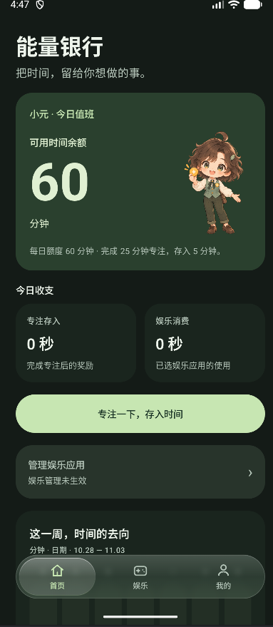
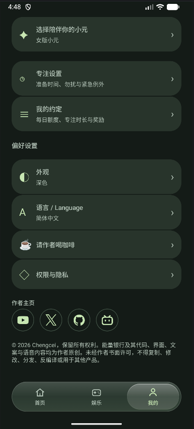

# Energy Bank 🌱

**Make time for what matters to you.**

[简体中文](README.md) · [Report a problem](https://github.com/chengcei/energy-bank/issues) · [Suggest an improvement](https://github.com/chengcei/energy-bank/issues/new)

Energy Bank is an Android time-management app in beta. Treat focus as a deposit and entertainment as spending, with Xiaoyuan by your side.

This repository contains the product overview, updates and feedback. The application source code is not published here.

## A bank for your time

- **Set your budget:** choose a daily entertainment allowance, focus duration and reward. The defaults are 60 minutes of entertainment per day and a 5-minute reward for completing 25 minutes of focus.
- **Deposit focus time:** allow yourself an optional preparation period, then confirm when you are ready to begin.
- **Track entertainment spending:** select apps to manage. With the required system access enabled, their usage reduces your allowance; when it runs out, Energy Bank brings you back to the app.
- **Meet Xiaoyuan:** choose a male or female companion with matching built-in Chinese and English voice prompts. Light, dark and system themes are available.
- **Choose quiet reminders:** optional focus Do Not Disturb and system screen pinning. Completion reminders are silent by default during Do Not Disturb, with a vibration-only option subject to system settings.
- **Keep it local:** core features work without an account. An optional local account supports an encrypted transfer string plus your original password to restore the exported account and ledger snapshot on another device. There is no automatic cloud sync.

## Screenshots

The screenshots below show the Chinese interface; English is also available in the app.

  
  

## Current status

**Current development version: 0.7.4-beta · Android beta**

This update restores the rounded card layout and adds YouTube, X, GitHub and BiliBili author icons at the bottom of the profile page.

Emulator checks have been completed. More testing on physical devices is needed, particularly for lock-screen and background completion reminders, entertainment deductions, and layouts at different screen and font sizes. The app has not launched on an app store. Please contact the author through the social profiles below about participating in testing.

## Feedback

Please use [Issues](https://github.com/chengcei/energy-bank/issues) and include:

1. Device brand and model, Android version and app version.
2. Steps to reproduce, expected behaviour and what actually happened.
3. For reminder problems, whether the screen was locked, the app was in the background, or Do Not Disturb or battery saver was enabled.
4. A screenshot or short recording, if convenient.

Do not post passwords, encrypted transfer strings or recordings containing private notifications.

## Author

[BiliBili](https://space.bilibili.com/3706947765274901) · [YouTube](https://www.youtube.com/@Chengcei) · [X](https://x.com/Chengcei_yt) · [GitHub](https://github.com/chengcei)

© 2026 Chengcei. All rights reserved.
