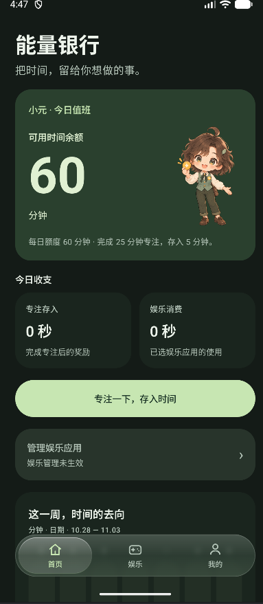
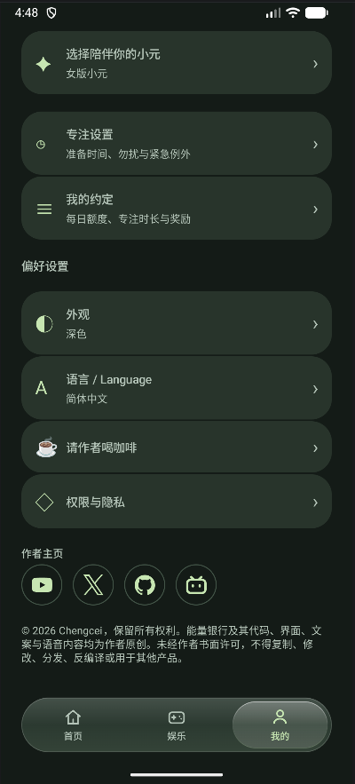

# 能量银行 · Energy Bank 🌱

**把时间，留给你想做的事。**

[English](README.en.md) · [反馈问题](https://github.com/chengcei/energy-bank/issues) · [提出建议](https://github.com/chengcei/energy-bank/issues/new)

能量银行是一款正在测试中的 Android 时间管理应用。把专注当作“存入”，把娱乐当作“消费”，让小元陪你慢慢找回自己的节奏。

这个仓库用于展示产品、记录更新和收集反馈，暂不提供应用源码。

## 时间也可以存起来

- **分配额度**：自己设置每天的娱乐时间、专注时长和完成后的奖励。默认每天 60 分钟娱乐额度，完成 25 分钟专注可存入 5 分钟。
- **专注存入**：可以先留一段准备时间，准备结束后亲自确认开始。
- **娱乐消费**：选择需要管理的应用，开启对应系统权限后按使用时间扣除额度；额度用完时引导返回能量银行。
- **小元陪伴**：男版、女版小元可选，对应中英文语音；支持浅色、深色和跟随系统主题。
- **按需安静**：可选专注勿扰和系统屏幕固定；勿扰期间结束提醒默认静音，也可选仅振动，具体表现受系统设置影响。
- **本地使用**：不登录也能使用核心功能。可选本地账号，通过“加密迁移串＋原密码”转移导出时的账号与账本快照；没有云端自动同步。

## 界面预览

  
  

## 当前进展

**当前开发版本：0.7.4-beta · Android 测试版**

这一版恢复了圆角卡片布局，并在“我的”底部加入 YouTube、X、GitHub、BiliBili 作者图标。

已进行模拟器验证，仍需要更多真机反馈，尤其是锁屏与后台结束提醒、娱乐额度扣除，以及不同屏幕和字体大小下的排版。应用尚未正式上架；测试包的获取安排请通过作者社交主页咨询。

## 帮忙测试或提出建议

欢迎在 [Issues](https://github.com/chengcei/energy-bank/issues) 留言。报告问题时，请尽量写明：

1. 手机品牌与型号、Android 版本、应用版本。
2. 你做了哪些操作，以及原本期待什么、实际发生什么。
3. 如果是提醒问题，说明当时是否锁屏、在后台、开启勿扰或省电模式。
4. 如果方便，附截图或短视频。

请勿在公开反馈中附上账号密码、迁移串或含私人通知的原始录屏。

## 找到作者

[BiliBili](https://space.bilibili.com/3706947765274901) · [YouTube](https://www.youtube.com/@Chengcei) · [X](https://x.com/Chengcei_yt) · [GitHub](https://github.com/chengcei)

© 2026 Chengcei，保留所有权利。
